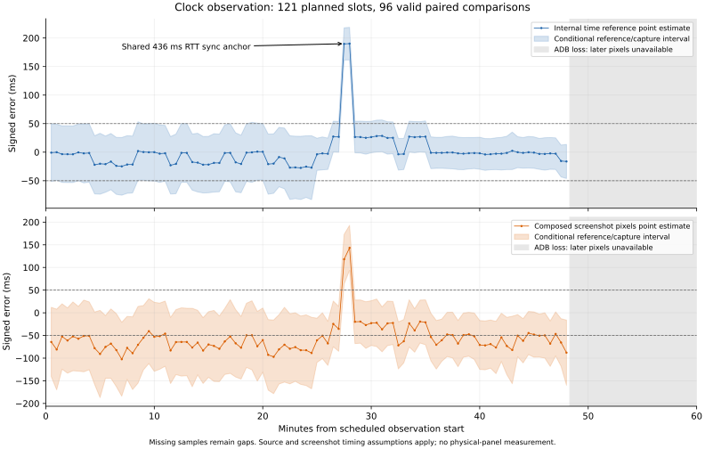
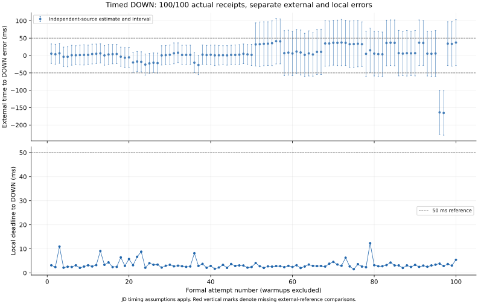

# 两部分精度采集结果

日期：2026-10-29。只用现有模拟器；生产计时、校时、绘制及点击算法未修改。对应[事前计划](ACCURACY_CAPTURE_PLAN.md)。此报告区分“数字取时是否准确”“合成画面是否及时”“真实按下是否准时”，不拿onClick替代DOWN。

## 结论

1. 周期同步确实更新参考，但当前的50ms精度目标不能判为通过：采到一次436ms RTT校时后参考快约190ms的异常，两个合成画面样本在参考假设下也可确认超过50ms。另有94个有效屏幕对照因范围跨50ms而无法确认；25个时隙的缺失/失败不隐藏。
2. 点击执行相对本地截止，100/100收到按下且均未超过50ms；但相对独立同源参考，存在2次可确认超50ms的提前点击。因此内部调度较快并不代表外部设定时刻准确。
3. 两次实际提前均引用RTT465ms的同一校时锚点；同次ARM快照中的任务参考与最新来源一致，最终截止对应的参考也未改变。现有证据支持先研究校时样本质量与误差预算，而不是先把主线程/绘制认定为这两次超差的原因。本轮只采集分析，没有修复或改变生产算法。

## 采集范围与中断

时钟组约48分钟时ADB传输中断，主机退出255；设备没有重启、应用进程未重启，但UiAutomation截图接口失效。原定一小时循环自然结束，121个时隙全部保存，后段缺失未补采。原主机失败报告保留；设备文件另取到clock-60min-recovered，质量仍为host_failure。下表时钟分位数只描述96个有效样本，不能当作完整一小时的绿色验收。点击组随后按原参数独立采集，未重跑或替换时钟失败项。

- 同一boot `e96ade37-b376-4975-b473-53af6e1cfe8d`、同一优化测量APK与目标APK，生产Activity不附加Instrumentation。关闭高频打点、旧绘制字符监听和Perfetto；源为京东OPTIONS，应用每60000ms同步。
- 时钟60分钟固定每30秒，共121/121个时隙；有效数值96，失败25。保存完整PNG、采集时间包围、独立前后请求与源锚点；没有用应用字符给截图贴标签。
- 预热10/10次独立列账。短任务正式100/100实际接收；15秒设置预算、4秒提前公开播放。另一次20分钟等待，收到1/1；单样本不并入短任务分位数。
- 原始数据根目录`.tools/accuracy/20261029T011625Z`，各组保留独立原始ID。预检、构建/驱动失败不删除、不填入正式分母；分析和证据索引见文末。

## 中位数与尾部分位（毫秒）

| 指标 | 有效n | 中位数 | P95 | P99 | 最大 |
| --- | --- | --- | --- | --- | --- |
| 内部校时参考：绝对误差点估计 | 96 | 3.725 | 27.552 | 190.188 | 190.188 |
| 悬浮时钟合成像素：绝对误差点估计 | 96 | 63.770 | 92.844 | 143.303 | 143.303 |
| 外部设定时刻→实际DOWN：绝对误差点估计 | 100 | 6.248 | 37.265 | 163.632 | 165.388 |
| 本地截止→实际DOWN：延迟 | 100 | 2.935 | 6.698 | 10.944 | 12.347 |

这里前三项是独立参考包络中点的**绝对误差点估计**，不能忽略下表的不确定度。中位数为偶数样本中间两项平均，P95/P99采用nearest-rank；原始分析的nearest-rank P50仍保留，另存展示统计，不覆盖原报告。每组P99只是表内有效样本的分位，缺失限制整体判断；n不足100时P99可能等于最大，不是稳定长期上限。

| 50ms区间判定 | 可确认≤50ms | 可确认>50ms | 无法确认 |
| --- | --- | --- | --- |
| 合成画面 | 0 | 2 | 94 |
| 外部时刻→真实DOWN | 46 | 2 | 52 |

缺失/识别/参考失败另列，不算通过。点估计超过50与区间确认超过50分别计数，不能混用。任何一项仍有无法确认或缺失，就不能宣称该项全部通过。

## 定时同步是否有效

有效对照样本里观察到48个不同成功参考锚点。有效样本首尾各四分之一的误差、校时年龄、独立请求RTT和截图耗时全部保留在`analysis.json`与`presentation-statistics.json`，用来区分固定偏差与随时间累积的漂移。锚点更新说明周期同步被采用；精度仍要独立比较，不能仅凭“同步成功”判断；时钟后段缺失的像素精度仍未知。

内部校时参考与合成画面的分布分别报告。画面落后可能发生在绘制、提交或采样捕获阶段，不等于内部时间永久累计错误；显示滞后也不直接加进点击误差。点击总误差由独立同源请求与目标入口读时计算，不使用悬浮数字反推。

## 本轮已定位的超差锚点

时钟第55、56号时隙（在ADB中断之前）共用`sourceAnchorElapsed=47191235`。应用保存的该次校时RTT为436ms，两个采样时内部参考分别快189.637、190.188ms；独立请求包络给出的偏差范围分别为[161.392,217.882]、[161.657,218.717]ms，均超过50ms。两张合成画面分别快118.138、143.303ms，其区间下界63.284、93.620ms也超过50ms。

第54号时隙来自前一锚点（RTT116ms、参考偏差26.868ms）；第57号换成新锚点（RTT112ms），参考偏差回落到26.518ms。原始图片`screen-055.png`、`screen-056.png`和完整前后请求均保留。这是一段可观察的校时基准跳变及随后恢复，不是凭绘制回调次数推算的累积漂移。

代码的样本接收门槛允许RTT至2000ms，436ms会被接收并标为fresh；fresh只描述样本新鲜程度，不表示误差保证。现有证据支持优先研究校时样本质量控制；尚未区分这436ms由网络、服务端排队与客户端调度各占多少，也没有在本轮修改算法。时钟组没有在该异常锚点下实际执行点击，不能把它直接填成已观测点击误差。

点击组另有独立证据，不能与上述436ms事件混为一次：

| 正式任务 | 引用锚点 | ARM时来源RTT | 本地DOWN迟到 ms | 外部DOWN偏差点估计 ms | 外部偏差区间 ms |
| --- | --- | --- | --- | --- | --- |
| 96 | 51711189 | 465ms | +3.841 | −163.632 | [−227.161,−100.103] |
| 97 | 51711189 | 465ms | +2.876 | −165.388 | [−229.182,−101.594] |

外部偏差为负表示提前，统计绝对误差时不能把它丢掉。任务参考偏快的同次推导为“本地迟到−外部偏差”：约167.473、168.264ms；这是逐条读数推导，不是将两个分位数相减。原始ARM/回执/前后参考及输入hash对齐在`anomaly-findings.json`。外部参考的时间语义、500ppm敏感性和网络范围假设仍适用，不能当绝对UTC认证。

## 方法与边界

1. 合成屏幕由UiAutomation截图，调用前后使用设备elapsedRealtimeNanos包围。独立字体/几何模板解码真实像素，三个已知字符串控制、空白拒绝和人工抽查；保存所有低置信/错误截图。预检发现首次截图冷启动约1176ms，正式组事前固定一次不入分母预热；其他调用时间仍原样保留。
2. 独立进程前后另发京东OPTIONS，记录连接前sent、connected、received、原始请求ID/Date/Age，严格拒绝坏头/缓存/冲突。它们不写回应用参考。假设请求ID时间发生在请求期间，完整请求形成offset包络，保留冲突；不把TLS后读时伪装为全部误差边界。
3. 包络含1ms时间戳预算及±500ppm外推敏感性假设。500ppm不是实测硬件上限，京东请求ID也无公开授时SLA，因此“可确认”以这些假设为条件，不宣称绝对UTC认证。截图的不确定时间范围全部计算在内，不从分位数中扣除空计时器或截图耗时。
4. 真实DOWN在独立目标Activity触摸分发入口取elapsedRealtimeNanos，在原有JSON/UI工作之前；同次目标/截止、唯一DOWN/UP/onClick及COMPLETED核对。原始派发记录不是实际接收；不把不同分位数相减充当阶段耗时。公开操作和停止路径保持。
5. 每30秒采样无法排除间隙内短暂卡顿；截图表示模拟器合成内容，不是物理屏幕出光。截图和参考请求有开销，不能把本组称为完整、无干扰帧性能基线。长等待仅一例，不提供长等待P99保证；新旧boot、预热与诊断不合并。

原始[Android截图定义](https://developer.android.com/reference/android/app/UiAutomation#takeScreenshot())与[帧时间线定义](https://perfetto.dev/docs/data-sources/frametimeline)用于限定观测范围。生产算法的优化应另建单变量实验，本轮没有保留或引入生产性能改动。

## 验证、恢复与索引

最终检查与原环境恢复的权威状态记录在[本轮索引](acceptance/2026-10-29-accuracy.json)，未完成恢复不得在交付中宣称恢复。源码前后核验要求app/src/main与core/src/main零变化；仅benchmark测量、独立目标与分析工具/文档允许变化。不提交SDK、本机证书/路径、原始大文件或APK；未提交或推送。

## 图表与完成检查

20分钟等待的单次结果：本地DOWN迟到3.014ms、外部偏差点估计+1.233ms，在既定参考包络假设下可确认≤50ms。它不用于短任务P99，也不保证任意长等待。

49个工具测试、5个统计报告测试通过；标准/辅助构建和Lint通过，70个未变更核心/应用单测结果由Gradle复用，9个目标工具单测结果通过。普通Debug/Release清单和DEX无新测量入口；未运行新的完整32项功能或真机验收。

原APK SHA-256为`e06d2d7657d8aadda131ae74c972b04c5fbfc54def4ee539ce21946e8b1ee92f`，已与安装包核对；启动后偏好、包清单、服务和系统设置与备份相同，活动trace0。恢复首次因未安装可选测试包的查询退出码中断，原失败保留，继续核对通过；没有覆盖失败记录。采集后仅修复工具的断线退出/可选包判断，未改生产行为或算法，未提交推送。
