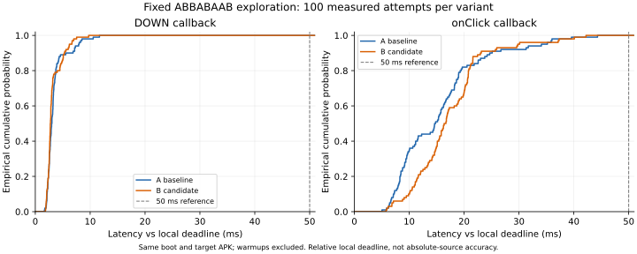
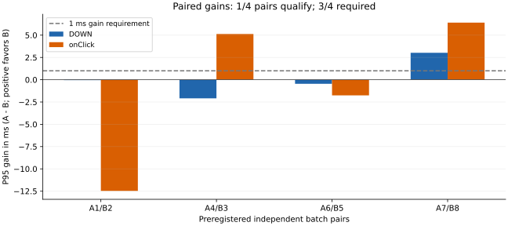

# 测量修复与单变量实验结果

日期：2026-10-28～29。对应 [计划](MEASUREMENT_REPAIR_PLAN.md)。本轮修复、测量、候选判定和恢复已结束；**完整帧呈现和高频打点未通过准入，不能宣称所有性能问题已解决**。仅使用模拟器，原 V3 正式矩阵、严格每次50ms及小时级新验收均未通过或未执行。

## 当前结论

| 项目 | 已取得的证据 | 状态 |
| --- | --- | --- |
| 原始帧字段 | 固定处理器版本逐包审计，与871次原始解析错误对账；均为主present_type=0，结构错误0 | 审计完成；未知主类型保留 |
| 窗口和令牌关联 | 创建前唯一窗口名、HWUI原始vsync及显示令牌；120秒3246次绘制唯一关联 | 关联修复通过该局部验证 |
| 完整可见呈现 | 2580次已知类型，373次surface类型未知、293次display类型未知 | 不通过，不用已知子集冒充整体 |
| 时基 | 3次marker均在前后读数内，46份BOOTTIME快照身份一致；含快照离散与uptime量化的转换预算1.4288ms | 该轨迹局部校验通过1.5ms门槛 |
| 打点开销 | 原始记录P99超过10μs；完整帧诊断CPU增量中位超过2个百分点 | 不通过，仅作诊断 |
| 无高频观察实际接收基线 | 新boot固定8批全部完成，200次测量及80次预热全部唯一接收，质量与公开流程审计通过 | 当前受控场景基线成立；不外推长期/绝对精度 |
| 单变量生产候选 | 手势预构造仅1/4配对达同时改善，onClick中位增加1.739ms | 按原规则撤回，源码/测试/APK归档；未进入千次确认 |
| 最终回归及恢复 | 标准/工具检查、32项功能及独立进程重建通过；原APK/偏好/设置已核对恢复，新增测试包移除、trace为0 | 本轮交付检查完成 |

## 本地原始档案

运行根目录：`.tools/measurement-repair/20261028T172912`，由`.tools/measurement-repair-current.txt`指向。开始前已保存整个工作区源码快照、原APK、偏好及系统设置；这些是恢复依据，不能用HEAD覆盖已有工作。

- `frame-repair-01`：后设窗口名未改变VRI身份，2963次绘制均缺窗口祖先；失败保留。
- `frame-repair-02`：启动/心跳失败；不作为完成的帧试运行。
- `frame-repair-03`：120秒完整记录、原始trace、SQL导出、二进制事件和`wire-audit`。解析错误871及丢弃块19原样保留。
- `failure-diagnostics/clock-alignment-recheck.json`：用最新预算计算器离线复算；原trace SHA-256为`f0b746ac4f242246d08de0cd77787e589e754ecd57548f5ffea2ea6cfe09f185`。
- `calibration-light-01`、`calibration-light-02`：所有50000次原始耗时及第二轮空计时器对照。
- `overhead-*`及`overhead-matrix.json`：3个交错块、9个完整60秒稳定资源组。
- `driver-v2/discovery-01-A`：严格驱动第3次预热停批，计划35次、已执行3次、完成2次、失败1次、未执行32次。不能用完成的2次计算一个“通过的基线”。
- `driver-v2/preparation-diag-01`：IDEA关闭导致模拟器退出；重启后只恢复4条完整任务链和不完整尾部，另存`recovered-after-restart/partial-diagnostic.json`，不覆盖原件。
- `boot2/preparation-diag-01`：独立启动后10次轻量诊断，10次均实际接收。它不是关闭观察器基线，更不能与重启前互作优化对照。
- `failure-diagnostics`：新增失败诊断的源码、APK、mapping、hash、RED/GREEN日志。
- `boot2/failure-diag-02`：预定30次失败原因诊断已完成，30/30实际接收，无诊断丢弃或失败。准星移除P95 7.502、最大9.433ms，准备阶段P95 10.173、最大18.391ms；未复现旧FAILED，不能补造历史原因。
- `boot2/discovery-v3`：补充仅在失败分支触发的observer后，共同测量源码及基线A已冻结；app SHA-256为`a4ceed236a32fb0a3444fe3a187c33696ccfc2da29e1f3c7f42439ec6369381f`，目标为`baf574a812bf76b8e8f62e6669ce36de980e4d69868e30e31081894440b68cc6`。候选B必须用同一共同源码另构建，不能沿用前一测量版本。
- `boot2/admission-off-10`：最终共同测量版本的独立10次off准入完成，10/10接收、高频写入0、无失败原因记录。DOWN P50 2.855、P95/P99/最大6.029ms；onClick P50 12.739、P95/P99/最大42.282ms。仅准入小样本，不替代正式对照。
- `boot2/discovery-v3/discovery-matrix.json`：共同测量版A/B冻结后完成固定ABBABAAB探索。B仅将原有手势构造移至已有准备阶段，hash为`0e00d59d7e769dde3861eeeebe92bd37a8d80fe785afce4555f2f8192773fd63`；生产差异另存`production-single-variable.patch`。工作树保持基线，按归档APK执行实验，采集中未构建或调整生产路径。

## 帧与时基修复的含义

Trace Processor固定为v58.2、提交`add693d8b338ba9599dbcbc3e300b1ab8c000897`。原始审计器保留包位置、时刻、clock_id、cookie、PID及所有字段；字节按hex无损保存。结构错误与主/辅助呈现枚举未知分开，不用experimental类型覆盖主类型，不修改原trace或删除官方计数。

Choreographer嵌套动画resync标签不等于实际提交HWUI的缓冲令牌。使用创建前的`clock_<session>`窗口名、drawId区间、原始doFrame祖先、同窗口draw-VRI，以及精确surface/display token；不使用最近时刻猜测。修正后3246次唯一关联，但666次主类型未知仍拒绝计作成功显示。

已知类型子集的draw→present为P50 38.203、P95 117.211、P99 208.084、最大426.735ms。**这是筛选后的诊断分布，不是整个悬浮时钟的有效性能验收。**

marker之前的业务读数到marker之间会包含线程暂停，不能叫时钟漂移。3次真实包围宽度为70、32、31.9μs；BOOTTIME/elapsed同域。额外计入1ms的uptime量化及快照读数离散，得到1.4288ms预算。该检查不证明外部来源绝对准确，也不代表目标应用每次接收只差1.43ms。

## 打点和资源开销

| 50000次原始测量 | P50 | P95 | P99 | 最大 |
| --- | --- | --- | --- | --- |
| 首轮完整记录 | 19.8μs | 31.1μs | 50.6μs | 约12.1ms |
| 缓存tid后的完整记录 | 20.2μs | 29.2μs | 112.8μs | 约9.83ms |
| 同轮空计时器 | 9.4μs | 13.1μs | 19.6μs | 约11.21ms |

不能将两个P99相减作为记录器真实P99，不因为模拟器慢而放宽门槛。第二轮早期的Instrumentation结果曾超出Binder事务大小；原始数据已落盘，随后改为仅返回路径，原始失败仍保留。

每个资源组预热10秒，稳定60秒；CPU按同PID的设备`/proc`时钟计数，USER_HZ=100，PSS取TOTAL PSS。CPU以单核百分比报告：

| 模式减off | 3个块的app CPU差值（百分点） | 中位 | app PSS最大增量 | target PSS最大增量 |
| --- | --- | --- | --- | --- |
| light | +3.651、−3.000、+0.049 | +0.049 | 1735KiB | 436KiB |
| frame | +7.896、−1.197、+4.397 | +4.397 | 3618KiB | 592KiB |

trace服务合计PSS最大46365KiB；单独预算，不混作app。PSS增量在4MiB内，frame CPU门槛失败。off本身CPU也有38.48%～43.42%的跨块变化，不能把所有差值都断言为采集因果。20对任务新增迟到及关键区累计开销尚未通过，失败模式暂停正式收益测量。

off模式不安装高频观察器/逐帧字符串监听器，不分配二进制TimingBuffer；目标入口仍保留有界标量回执。最新共同测量版本另装仅在失败分支调用的observer，保存最后失败事件/原因/最多2048字详情，随已有被动状态返回，不在成功路径记录。该比较只能报告相对生产本地截止的真实接收延迟，不能证明京东来源的绝对50ms。

## 点击驱动与失败台账

原驱动3秒设置预算不足，曾在晚于截止约379ms时误读旧任务记录，后续又把自动启用任务停止；该批及手动中止的候选批都不用于收益判断。修订为15秒固定设置预算、缓存公开播放节点、D−4000ms按公开ACTION_CLICK播放；必须匹配本次目标、ARM校验时刻并在D−750ms前完成被动读取。

每任务要求唯一B点DOWN/UP/onClick、无未闭合触摸、生产COMPLETED。预热失败也停批，未执行项保留，不能只统计收到的样本。关闭记录器时直接读取原始生产终态，不把默认数字0当成成功。

旧boot的off准入10/10接收，DOWN P50 12.630、P95/P99/最大56.870ms；onClick P50 39.101、P95/P99/最大163.898ms。n=10时高分位等于最大，不作为稳定P99。其后独立探索第3次预热FAILED且无派发；**没有足够历史打点确定是哪一个保护分支，仍未知**。

新boot的10次light诊断同样不能证明优化：DOWN P50 2.827、P95/P99/最大6.433ms；onClick P50 13.115、P95/P99/最大66.656ms，1次超过50ms。这既有重启差异也有观察器差异，禁止与旧off组拼接或作收益比较。

新增失败专用事件32/46及107拒绝原因，经测试确认诊断写入异常不改变任务结果、不产生重试。成功路径不增加新高频打点；新APK和协议独立标识，旧数据不补写原因。

## 完整ABBABAAB探索（2026-10-29完成）

同一独立启动、同一目标APK、相同公开操作/配置、优化包及编译模式，8批均完整。每版本4批×25测量＝100次，另40次预热单列；总200次测量＋80次预热全部B点唯一DOWN/UP/onClick、COMPLETED，无提前。旧boot及准入/诊断数据不混入。

| 版本/入口 | n | P50 ms | P95 ms | P99 ms | 最大 ms | >50ms | 测量接收率 |
| --- | --- | --- | --- | --- | --- | --- | --- |
| A基线 DOWN | 100 | 2.975 | 7.892 | 10.555 | 11.690 | 0 | 100/100 |
| B候选 DOWN | 100 | 2.734 | 6.205 | 7.533 | 9.723 | 0 | 100/100 |
| A基线 onClick | 100 | 14.625 | 34.088 | 39.573 | 44.319 | 0 | 100/100 |
| B候选 onClick | 100 | 16.365 | 29.786 | 40.094 | 42.218 | 0 | 100/100 |

数值为相对生产本地截止的入口读时。截止量化到毫秒，目标入口使用elapsedRealtimeNanos；n=100的P99不作稳定尾部承诺。当前100次均≤50ms不能证明来源绝对误差、任意负载、长期运行或每一次都≤50ms。A的历史更差结果继续保留，不能把新boot/无IDEA条件的基线变化算成代码优化。

| A/B配对批次 | DOWN P95改善 ms（A−B） | onClick P95改善 ms | 两者均至少1ms |
| --- | --- | --- | --- |
| 1/2 | −0.046 | −12.475 | 否 |
| 4/3 | −2.087 | +5.131 | 否 |
| 6/5 | −0.457 | −1.756 | 否 |
| 7/8 | +3.022 | +6.406 | 是 |

只有1/4配对符合要求，未达3/4；B的onClick中位从14.625变16.365ms，增加1.739ms，超过原定1ms非回退容差。候选没有通过预注册规则，已撤回。没有改变门槛或再跑一轮挑结果；千次独立确认按计划不启动。

新增质量自动检查先RED后GREEN：即使passed=true且回执完整，错误、丢失、缺/坏元数据、非off模式或异常监督终态也拒绝准入。旧分析器冻结副本保留，修正后代码及hash在`analysis-quality-v2`；原报告不覆盖，新报告为各批`repair-report-quality-v2.json`。35个分析测试通过。本轮8批的app/target丢失、观察器异常、收集错误均0，off二进制为空；`quality-audit-all8.json`与`public-flow-audit-all8.json`保存逐批质量及280次目标/公开播放/ARM/截止/入口顺序核对。最终判定为`discovery-comparison.json`：eligible=true，discoveryPassed=false，retentionApproved=false。

候选`PreparedTap`及其测试已在`withdrawn-candidate`保存后从工作树移除，ClickService保持冻结A基线，测试版失败通道仍保留。绘制OPAQUE候选前提不成立的结论不变；本轮没有新绘制收益结论。

## 独立控制、最终检查与恢复

两项[平台控制](MEASUREMENT_FAILURE_CONTROL.md)均通过，使用独立测试版本，不进入上述性能分母：

- 阳性控制先排入待执行阻塞，再结束并替换会话；等待1200ms后无执行/泄漏，随后公开播放收到唯一B点DOWN/UP/onClick、COMPLETED，failureEvent=0、高频写入0。
- 拒绝控制实际阻塞670.801ms，范围为D−498.591～D+172.210ms，原生产保护返回FAILED、event107/reason4，无派发、0个目标入口、高频写入0。只验证该真实分支和诊断通道，不据此给历史未知FAILED归因。

JDK17、D盘Gradle缓存下，最终70个核心/应用单测、9个目标工具单测、35个分析测试、5个统计报告测试通过；Debug Lint、普通Debug/R8 Release、测量/目标构建与Lint通过。普通APK清单无测量Provider/profileable，DEX无故障注入命令。32项完整模拟器功能均通过；独立进程重建PID 20417→20565，终止前后实际接收保持2次，重建后观察3000ms无增长。预期的“Process crashed”与新PID/稳定计数一起核对，未当作普通崩溃通过。

原APK SHA-256 `e06d2d7657d8aadda131ae74c972b04c5fbfc54def4ee539ce21946e8b1ee92f`已逐字节核对；偏好在启动前、启动后均与备份相同，无障碍服务和两项系统设置恢复，新增目标/仪器化包移除，活动trace为0。保留独立启动的原AVD，不恢复退出依赖；本轮未提交或推送。

最终[证据索引](acceptance/2026-10-29-measurement-repair.json)列出原始档案、完整hash清单、源码前后差异及可复现统计。延迟CDF与配对收益均从固定完整样本生成，未平滑、未删尾部：

## 复现与限制

`tools/profiling/frame_protocol.py`负责原始包审计，`v3_analysis.py`负责严格关联与包围时基，`repair_report.py`负责分母和延迟，`repair_compare.py`负责固定ABBA/BAAB探索判定。比较器拒绝缺批、跨boot、无效预热、提前接收和尾部回退；即使探索通过也不能自动批准保留，仍需独立确认。

中间共同测量版本73个核心/应用单测含3个候选缓存测试，已随候选撤回归档；最终计数70，不以中间计数冒充当前测试。关闭观察器的可靠基线与撤回判定完成，未通过的帧/开销模式按协议停止正式测量。此结论是本轮实验的终态，不能解释为性能已优化到极限。

后续若要继续完整时钟呈现验收，先取得未知present_type的独立呈现证据，并降低/重新验证记录器开销；通过原门槛后再做正式矩阵。旧失败缺失的历史阶段无法补采，只能保留未知并在未来自然失败中使用新通道取证。来源绝对精度、真机、小时级漂移及任意负载的每次50ms均没有在本轮得到证明；没有以本轮n=100探索替代这些验收。
